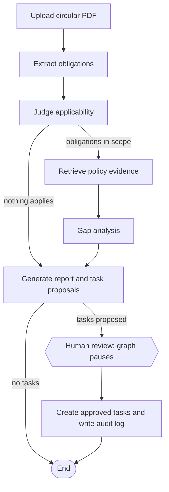

# RegulaAI

An agentic regulatory compliance assistant. It reads a regulatory circular, works out which obligations apply to a given financial institution, checks them against the institution's internal policies, and produces a cited gap report. A human reviewer approves the proposed remediation tasks before anything is created.

> **Status:** in active development. The core workflow runs end to end locally. The API, database, MCP tool servers and cloud deployment are not built yet (see the roadmap).
>
> **Not legal advice.** RegulaAI prepares evidence for a human compliance reviewer and never approves anything on its own. All documents in this repo are fictional and synthetic.

## The problem

Banks receive regulatory circulars from bodies such as RBI and SEBI. For each one, a compliance team has to read dense legal text, decide which obligations apply to their institution, find out whether existing policies already cover them, and plan fixes before the deadline. Small institutions face the same volume of regulation with much smaller teams.

## How it works



| Step | What it does |
|---|---|
| **Extraction agent** | Reads page-marked PDF text and returns structured obligations (section, page, type, explicit deadline). Code assigns IDs, and a grounding check verifies each obligation's text really appears in the source. |
| **Applicability agent** | Decides whether each obligation applies to the institution profile. When unsure, it keeps the obligation and flags it for review, because wrongly excluding a rule is worse than wrongly including one. |
| **Compliance RAG** | Policies are chunked by section, embedded locally, and searched with FAISS. Every hit keeps its source file and section so it can be cited. |
| **Gap analysis agent** | Judges each obligation as `covered`, `partial` or `missing`. Code verifies every cited evidence ID against what was actually retrieved, and flags low confidence or unsupported claims. |
| **Report agent** | The LLM writes one remediation task per gap. Code sets priority and due dates and renders a Markdown report with citations. |
| **Human review** | The LangGraph run pauses with `interrupt()`. Only tasks the reviewer explicitly approves are created, and every decision is written to an audit log. |

## Design principles

- **Citations everywhere.** Each finding links to a circular section and page, and to an internal policy file and section.
- **LLMs write language, code handles facts.** IDs, priorities, due dates, counts and citation checks are deterministic code.
- **Typed hand-offs.** Agents exchange validated Pydantic objects, never free text.
- **Honest uncertainty.** "No evidence found" is a valid answer, and uncertain cases are routed to a human.
- **Swappable LLM.** All model calls go through one small client, so providers can be changed in one place.
- **Testable without a network.** Agents accept any LLM object, so the test suite uses fakes and needs no API key.

## What works today

- [x] Page-aware PDF reading
- [x] Pydantic data models for circulars, obligations, findings, reports and tasks
- [x] Extraction agent with a source-grounding check
- [x] Applicability agent with conditional routing
- [x] Local embeddings (fastembed) and FAISS policy search
- [x] Gap analysis with citation verification and review flags
- [x] Report generation (structured and Markdown)
- [x] Human-in-the-loop approval with a task file and an audit log
- [x] Automated test suite (35 tests)

## Roadmap

- [ ] README architecture and evaluation write-up
- [ ] Labelled evaluation set and repeatable accuracy measurements
- [ ] MCP servers for policy search, control lookup, task creation and audit history
- [ ] FastAPI backend and PostgreSQL (including a durable LangGraph checkpointer)
- [ ] Docker, GitHub Actions CI, AWS (S3, ECS)

## Quick start (Windows PowerShell)

Requires Python 3.11 or newer.

```powershell
git clone https://github.com/Sakshiippe5/regulaai.git
cd regulaai
python -m venv .venv
.venv\Scripts\activate
pip install -e .
copy .env.example .env
```

The test suite needs no API key:

```powershell
pytest
```

To run the full workflow, create a free key at [console.groq.com](https://console.groq.com), put it in `.env` as `GROQ_API_KEY`, and set `GROQ_MODEL` to a chat model your account can use. Then:

```powershell
python scripts\make_sample_circular.py
python scripts\run_review.py
```

The run pauses and asks you to approve, reject or skip each proposed task. Results are written to the `outputs/` folder (`report.md`, `tasks.json`, `audit.jsonl`). To see the early-exit branch, pass `data\institutions\sample_nbfc.json` as an argument, since the sample circular is scoped to urban co-operative banks and small finance banks.

## Project structure

```
src/regulaai/
├── agents/       extraction, applicability, gap analysis, report
├── graph/        LangGraph workflow and human-review helpers
├── ingestion/    PDF reading
├── llm/          LLM client
├── models/       Pydantic schemas
├── rag/          chunking, embeddings, FAISS index
└── tools/        task creation and audit logging (to become MCP tools)
data/             fictional circular, policies and institution profiles
scripts/          runnable demos
tests/            pytest suite
```

## Evaluation and limitations

- On one synthetic circular with 6 obligations and 2 fictional policy documents, the system's verdicts matched my hand-labelled expectations on 5 of 6, and the sixth was a judgement call. This is a smoke test, **not a benchmark**. A proper labelled evaluation set is on the roadmap.
- LLM outputs vary slightly between runs even at temperature 0, so findings carry a confidence level and uncertain cases are flagged for human review.
- Retrieval ranks sections by semantic similarity, and the top hit is not always the best one, so the analysis step receives the top 3 and judges them. Similarity scores are never used as a pass or fail threshold.
- The review checkpointer is in-memory for now, so a paused run does not survive a restart.
- Task creation writes to a local JSON file until the MCP and database phases are built.

## Tech stack

Python, LangGraph, Pydantic, Groq (open-source models via API), fastembed, FAISS, PyMuPDF, pytest.
Planned: MCP, FastAPI, PostgreSQL, Docker, GitHub Actions, AWS S3 and ECS.